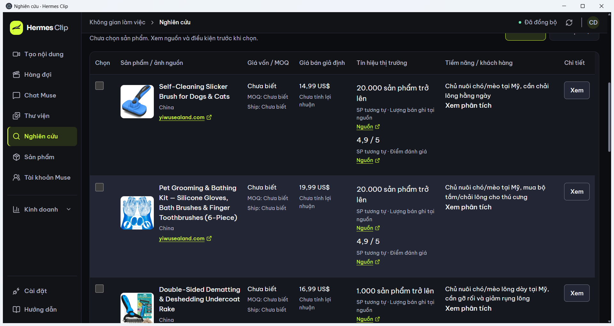
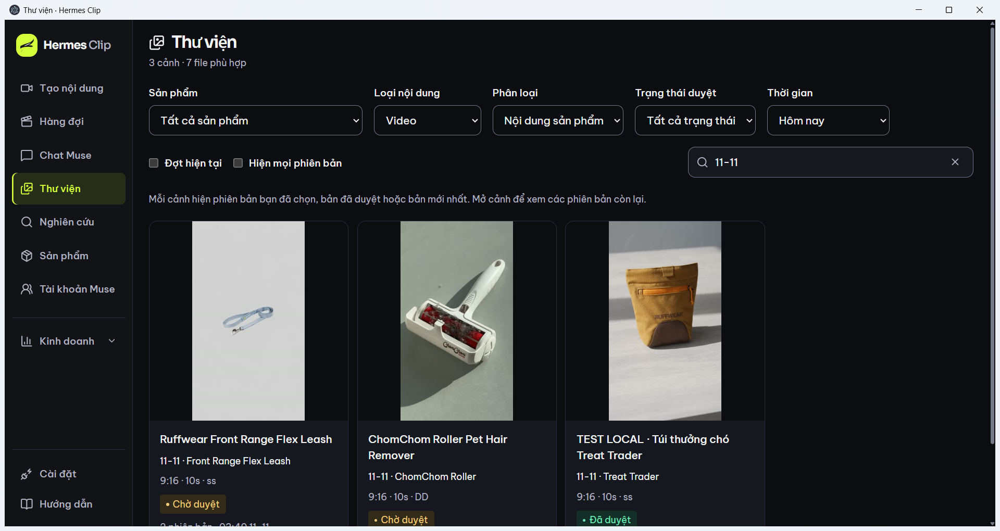

# Hermes Clip

Hermes Clip là ứng dụng desktop Windows để nghiên cứu sản phẩm, soạn và duyệt nội dung, tạo media qua Muse, quản lý video và đăng/đo số liệu Instagram theo sản phẩm.

Repository chứa source của bản cài được đối chiếu ngày **11/11/2026**. Dữ liệu người dùng, tài khoản và phiên trình duyệt được giữ trên máy Windows, không đi cùng repo. Đây là bản source phát triển; không phải bộ cài đã đóng gói cho máy mới.

## Luồng chính

Nghiên cứu 10 ứng viên → chọn tối đa 3 sản phẩm → soạn và duyệt kịch bản → Muse tạo ảnh/video → tải và nhập Thư viện → duyệt/xuất → đăng Instagram vào tài khoản đã chọn → tự đo số liệu.

Thị trường mục tiêu: Mỹ; nội dung sản phẩm: tiếng Anh. Giao diện dùng tiếng Việt. Muse có giới hạn 3 lượt/profile/đợt trong app, gồm chat, nghiên cứu và tạo media. App và máy phải hoạt động khi chạy tác vụ nền; chưa có lịch tự nghiên cứu mỗi đêm được nghiệm thu.

## Trạng thái và giới hạn

- Đã có bằng chứng lịch sử cho chat/research Muse, tải/nhập/phát lại video thật của ba sản phẩm, bảng 10 ứng viên và một lượt đăng Instagram thật.
- Instagram có bảng tổng quan theo sản phẩm và cơ chế đo số liệu. Hai sản phẩm còn lại chưa có lượt đăng thật được nghiệm thu.
- Dữ liệu research vẫn cần đối chiếu SKU, giá vốn và phí giao Mỹ. Số liệu sản phẩm tương tự không phải doanh số của đúng SKU.
- Checkout/pre-order chưa có cổng thanh toán hoặc điều kiện thương mại được chốt. Một số workflow Meosu như Remix, Clone qua Muse và tự nối cảnh chưa hoàn chỉnh hoặc chưa nghiệm thu.
- 248 test, build và TypeScript đạt trong bản cài ngày 11/11/2026. Đây là kết quả lịch sử; không phải bằng chứng CI hoặc cài sạch trên mọi máy.

Chi tiết: [Bối cảnh và trạng thái](docs/context/01-BOI-CANH-VA-TRANG-THAI.md), [bản đồ source](docs/context/02-SO-DO-SOURCE-VA-NGHIEM-THU.md), [Meosu](docs/MEOSU-IMPLEMENTATION.md), [lưu trữ](docs/STORAGE.md). Một số tài liệu cũ mô tả trạng thái trước ngày 11/11; ưu tiên context hiện hành và yêu cầu mới của người dùng.

## Phát triển trên Windows

Cần Node.js **24 trở lên**, pnpm theo `packageManager` trong package.json, npm, Chromium/Playwright, Electron và FFmpeg/ffprobe. Lockfiles được giữ trong repo. Chưa nghiệm thu cài sạch bản source trên một máy khác.

Tại thư mục repo, chạy PowerShell:

```powershell
pnpm install --frozen-lockfile
npm run local:build
Push-Location desktop
npm ci
npm run browser:install
Pop-Location
.\START-HERMES-CLIP.cmd
```

Đặt FFmpeg/ffprobe trên PATH hoặc trong `desktop/tools/ffmpeg/bin`. Tích hợp Agent Reach/OpenMontage có script riêng `desktop/SETUP-INTEGRATIONS.ps1` và revision trong `desktop/integrations-lock.json`; chỉ cài khi cần phần tương ứng. Repo không chứa môi trường Python, binary hay cấu hình tài khoản của các tích hợp.

`START-HERMES-CLIP.cmd` cần UI đã build ở `desktop/local-dist`. Sau mỗi lần sửa source, build lại trước khi mở app. Không dùng `npm run install:ci` cho bản local này: script đó là dấu vết môi trường hosted cũ và không có file tương ứng trong source bản cài.

**Máy đang có Hermes Clip:** launcher có thể dùng chung `%APPDATA%/product-lab-desktop` với bản cài. Đóng bản cài an toàn và sao lưu dữ liệu trước khi thử một checkout khác; không chạy song song hai bản trên cùng DB. Đừng thay DB hoặc profile thật bằng dữ liệu seed mẫu.

## Kiểm tra

```powershell
npm test
npm run test:api
npm run test:desktop
npm run test:codex
npm run typecheck
npm run local:build
```

Một số test media/integrations cần Python, FFmpeg và môi trường tích hợp local. Đọc test trước khi chạy; ghi rõ dependency còn thiếu. Kiểm tra app thực tế vẫn cần Windows GUI và người dùng đăng nhập Muse/Instagram. Không coi fixture hoặc phiên đăng nhập là bằng chứng đã tạo media hay đăng bài thành công.

## Kiến trúc

| Thư mục | Trách nhiệm |
| --- | --- |
| `components/lab`, `app/*.css`, `desktop/ui` | UI React, desktop entry và theme |
| `lib/lab`, `app/api`, `drizzle` | Domain, hợp đồng dữ liệu và API |
| `desktop/src` | Electron, worker Muse/Instagram, profile, quota, media và storage policy |
| `desktop/local` | HTTP server local, SQLite, nhập file và thumbnail |
| `tests`, `desktop/test` | Test domain, API, runner và desktop |
| `docs/context` | Bối cảnh cho ChatGPT và mẫu giao việc về Codex |

Giao diện mẫu:





## ChatGPT và Codex

ChatGPT đọc source/context để đề xuất; người dùng đưa prompt về Codex để triển khai. Tuân thủ [AGENTS.md](AGENTS.md): chỉ **một agent**. Sau mỗi đợt sửa, cập nhật context theo [mẫu bàn giao](docs/context/07-CAP-NHAT-SAU-MOI-LAN-SUA.txt). Upload hoặc kết nối repo không tự đồng bộ source với bản cài Windows.

Các font/tài nguyên và tích hợp giữ thông tin giấy phép riêng trong source. Chưa thêm giấy phép phát hành mới cho toàn dự án.
